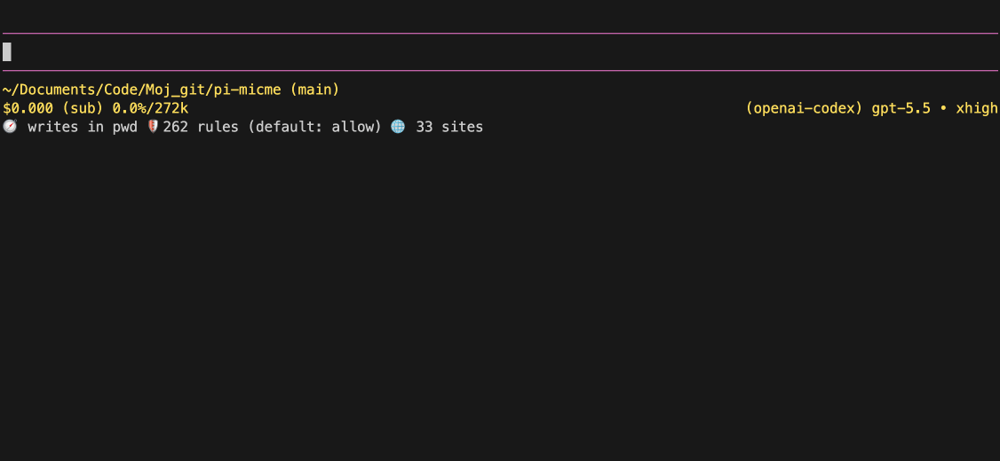

<p align="center">
  
</p>

<p align="center">
  <a href="https://pi.dev"></a>
  <a href="https://www.npmjs.com/package/@senad-d/micme"></a>
  <a href="LICENSE"></a>
  <a href="https://sonarcloud.io/summary/new_code?id=senad-d_micme"></a>
</p>

<p align="center">
  Local voice-to-text for <a href="https://pi.dev">pi</a>.
  <br />Tap a shortcut, speak, and paste the transcript into pi's editor.
</p>

---

MicMe is a Pi extension for coding prompts. It records your microphone with `ffmpeg`, transcribes locally with `whisper.cpp` or another local backend, and inserts the transcript into pi.

<table align="center">
  <tr>
    <th>MicMe demo</th>
  </tr>
  <tr>
    <td align="center">
      
    </td>
  </tr>
</table>

- **Local-first:** no telemetry and no cloud STT service by default.
- **Review-first:** review dictated text in the editor by default. Live dictation in a Pi RPC client requires [explicit replay](#live-dictation).
- **Pi-native:** install globally, project-locally, from git, or from a source checkout.
- **Configurable:** use `/micme conf`, `micme.json`, or shell variables.

> **Security:** pi packages run with your full system permissions. Micme can use your microphone, spawn local commands, write `MICME_*` settings, and optionally download Whisper model files. Read [`SECURITY.md`](SECURITY.md).

## Table of Contents

- [Quick Start](#quick-start)
- [Installation](#installation)
- [Pi Compatibility](#pi-compatibility)
- [Backend Setup](#backend-setup)
- [Configuration](#configuration)
- [Live Dictation](#live-dictation)
- [Commands](#commands)
- [Models and Backends](#models-and-backends)
- [Troubleshooting](#troubleshooting)
- [Diagnostics](#diagnostics)
- [Update and Uninstall](#update-and-uninstall)
- [Development](#development)
- [Publishing](#publishing)
- [License](#license)

---

## Quick Start

```bash
pi install npm:@senad-d/micme
```

Install a local backend. On macOS:

```bash
brew install ffmpeg whisper-cpp
```

Start pi and configure Micme:

```bash
pi
```

```text
/micme conf
/micme devices
```

Use it:

1. Press `alt+m` / `Option+m` to start recording.
2. Speak your prompt.
3. Press `alt+m` again to stop.
4. Review the pasted transcript and press Enter.

Micme is toggle-based. Press-and-hold recording is not used because terminal key-up events are not portable. A toggle received while Micme is starting, stopping, transcribing, or finalizing is rejected with a warning; wait for that operation to finish before toggling again.

---

## Installation

| Scope | Command | Notes |
| --- | --- | --- |
| Global | `pi install npm:@senad-d/micme` | Loads in every trusted pi project. |
| Project-local | `pi install npm:@senad-d/micme -l` | Writes to `.pi/settings.json` in the current project. |
| One run | `pi -e npm:@senad-d/micme` | Try without changing settings. |
| Git | `pi install git:github.com/senad-d/micme@<tag>` | Pin a tag or commit. |
| Local checkout | `pi -e .` | Develop or test this repository. |

Source checkout:

```bash
git clone https://github.com/senad-d/micme.git
cd micme
npm install --ignore-scripts
npm run doctor
pi -e .
```

Use the checkout globally while developing:

```bash
pi install /absolute/path/to/micme
```

---

## Pi Compatibility

Micme declares `*` as the peer dependency range for both `@earendil-works/pi-coding-agent` and `@earendil-works/pi-tui`. These published ranges are not a compatibility guarantee. CI pins both packages to `1.6.0` and tests only that version: it typechecks every production TypeScript file against their declarations and loads the default extension through Pi's jiti-based loader.

Before adopting another Pi release, review both published peer ranges and update the development pins and the contract test together.

---

## Backend Setup

Micme does not bundle executable binaries or model weights. The setup below is for the default clip mode. For live dictation, use the same recorder setup and see [Live Dictation](#live-dictation) for the worker.

| OS | Install | Device setting |
| --- | --- | --- |
| macOS | `brew install ffmpeg whisper-cpp` | Run `/micme devices`, then set `MICME_AUDIO_DEVICE=<audio id>` or `MICME_AVFOUNDATION_INPUT=:<audio id>`. |
| Linux | Install `ffmpeg` and `whisper.cpp` with your package manager, Nix, Homebrew, or source build. | `MICME_PULSE_SOURCE=default` |
| Windows | `winget install Gyan.FFmpeg`, then install/build `whisper.cpp`. | Choose **Microphone device** in `/micme conf`, or set `MICME_DSHOW_AUDIO_DEVICE=Microphone Name`. |

List devices inside pi:

```text
/micme devices
```

macOS device listing outside pi:

```bash
ffmpeg -hide_banner -f avfoundation -list_devices true -i ""
```

If `whisper-cli` is not on `PATH`, set it explicitly:

```env
MICME_WHISPER_CPP_BIN=/path/to/whisper-cli
MICME_WHISPER_CPP_MODEL=/path/to/ggml-small.en.bin
```

---

## Configuration

Micme reads settings from shell environment variables and from `micme.json` in the selected agent directory (normally `~/.pi/agent`). Shell variables win. `/micme conf` writes only `MICME_*` keys to that same file. See [Micme config handling](SECURITY.md#micme-config-handling) for directory precedence and which files to trust.

If this file is malformed or its top level is not an object, Micme refuses recording, model download, device discovery, and transcription before starting external work; `/micme conf` remains available so you can locate the file. After fixing it, reopen settings to discover devices and models.

Config saves are serialized in-process and across Pi processes with `micme.json.lock`, then atomically replace the file with mode `0600`. Each save re-reads the latest file while holding the lock and changes only its requested `MICME_*` keys, preserving `$schema` and other metadata. Saves commit in lock-acquisition order, so the last successful save to the same key wins. Micme waits up to five seconds for the lock; on timeout it leaves the existing config and lock untouched because it cannot safely assume another writer's lock is stale. Remove a leftover lock directory manually only after verifying that no Pi process is saving Micme settings.

Numeric settings such as the transcription timeout and clip sample rates use bounded integer values. The timeout accepts `1000..3600000` ms and also bounds live stages such as model readiness, PCM acknowledgments, and finalization. See [`micme.schema.json`](micme.schema.json) for ranges and defaults.

The usual setup path is to run:

```text
/micme conf
```

You can also edit the JSON manually. Minimal `micme.json`:

```json
{
  "$schema": "https://raw.githubusercontent.com/senad-d/micme/main/micme.schema.json",
  "MICME_LANGUAGE": "en",
  "MICME_TRANSLATE_TO_ENGLISH": "off",
  "MICME_TRANSCRIBE_BACKEND": "auto",
  "MICME_AUTO_DOWNLOAD_MODEL": "1",
  "MICME_DEFAULT_WHISPER_CPP_MODEL": "small.en",
  "MICME_AUTO_SUBMIT": "0",
  "MICME_KEEP_AUDIO": "0"
}
```

For temporary one-off overrides, set shell variables when starting pi, for example `MICME_KEEP_AUDIO=1 pi`.

Common settings:

| Variable | Meaning |
| --- | --- |
| `MICME_TRANSCRIBE_BACKEND=auto` | In clip mode, prefer a custom command, then whisper.cpp, then Python Whisper. In stream mode, use `micme-live`. |
| `MICME_TRANSCRIPTION_MODE=clip` | Default: transcribe after recording stops. Set `stream` for [live dictation](#live-dictation). |
| `MICME_LANGUAGE=en` | Transcription language when translation is off. Use `auto` for detection with multilingual weights. |
| `MICME_TRANSLATE_TO_ENGLISH=off` | “Translate from” option. Leave `off`, or set the spoken source language code such as `hr`, `bs`, `de`, or `tr` to output English. |
| `MICME_AUTO_SUBMIT=0` | Review in the editor. Set `1` to send eligible results automatically. Live RPC results always require explicit replay. |
| `MICME_SHORTCUT=alt+m` | Toggle shortcut. Use terminal syntax (`alt+m`, `ctrl+space`, `f8`) or a printable character such as `§`. Restart or `/reload` after changing. |
| `MICME_VALIDATE_AUDIO=1` | Clip transcription and optional refinement: reject near-silent audio and fail closed if ffmpeg omits or truncates `max_volume`. With a custom recorder and no ffmpeg, Micme warns and skips this guard. Set `0` to disable it. |
| `MICME_RECORD_SAMPLE_RATE=auto` | Clip recording sample-rate override. Leave `auto` to use the input's native rate. Stream capture is fixed at 16 kHz. |
| `MICME_RECORD_SYNC=1` | Preserve wall-clock recording duration from ffmpeg timestamps in the built-in recorder. |
| `MICME_RECORD_METER=0` | Clip only: meter from `raw.wav` by default. Set `1` to meter from a second ffmpeg stdout branch. Stream mode meters the PCM it reads. |
| `MICME_AVFOUNDATION_DROP_LATE_FRAMES=0` | macOS only: ask AVFoundation not to drop late frames when capture lags. |
| `MICME_KEEP_AUDIO=0` | Delete successful recording audio. Set `1` to keep each recording under `./micme-rec/rec-###/` for debugging. |
| `MICME_MODEL_DIR=~/.cache/whisper.cpp` | Model cache/discovery directory. |

See [`micme.example.json`](micme.example.json) for the full JSON template.

---

## Live Dictation

For English live dictation on a four-core CPU, try `base.en`. In a paced speech test, it showed the first relevant words in about 1.5 seconds and kept the visible draft relevant throughout all five runs at both terminal widths. The default `small.en` produced more accurate final text on that recording but fell behind while speech was in progress. Stream mode is experimental: these measurements used recorded speech, not a microphone. See [Models and Backends](#models-and-backends) to select a weight.

### Set up or migrate

1. [Build and install `micme-live`](native/live/README.md). Installing Micme does not build the worker. `whisper-stream` is not a substitute, and `whisper-cli` is not needed for live decoding itself.
2. Use the same microphone settings as clip mode: `MICME_AVFOUNDATION_INPUT` (or `MICME_AUDIO_DEVICE`) on macOS, `MICME_PULSE_SOURCE` on Linux, and `MICME_DSHOW_AUDIO_DEVICE` on Windows. A legacy SDL capture ID does not select a device in the new worker.
3. Select stream mode in `/micme conf` or set `MICME_TRANSCRIPTION_MODE=stream` in `micme.json`. Live decoding requires `MICME_TRANSCRIBE_BACKEND=auto` or `whisper.cpp`. Switching modes saves only the mode; it does not change your model, device, or refinement settings.
4. Run [doctor](#diagnostics) to check the resolved worker, speech recognition (ASR) weights, speech detection (VAD) weights, and language. Before opening the microphone, Micme provisions missing supported weights if enabled and waits for the worker to load both models. If setup fails, fix the reported issue or choose clip mode; Micme does not silently fall back to another backend.

Example `micme.json` when the worker is not on `PATH` and the VAD file is stored outside the model cache:

```json
{
  "MICME_TRANSCRIPTION_MODE": "stream",
  "MICME_TRANSCRIBE_BACKEND": "auto",
  "MICME_LIVE_BIN": "/path/to/micme-live",
  "MICME_VAD_MODEL": "/path/to/ggml-silero-v5.1.2.bin"
}
```

Use existing paths, or omit `MICME_LIVE_BIN` to find `micme-live` (`micme-live.exe` on Windows) on `PATH` and omit `MICME_VAD_MODEL` to use the standard cached weight. The same keys can be set in the shell and take precedence over JSON. See [Models and Backends](#models-and-backends) for ASR selection and [Model downloads](SECURITY.md#model-downloads) for cache paths, provenance, and offline setup.

**Migrating from `whisper-stream`:** `MICME_WHISPER_STREAM_BIN`, `MICME_STREAM_CAPTURE`, `MICME_STREAM_STEP_MS`, `MICME_STREAM_LENGTH_MS`, `MICME_STREAM_KEEP_MS`, `MICME_STREAM_MAX_TOKENS`, `MICME_STREAM_KEEP_CONTEXT`, `MICME_STREAM_WORDS_PER_CHUNK`, `MICME_STREAM_FLUSH_MS`, and `MICME_STREAM_VAD_THRESHOLD` are ignored. Stored values are left intact. Use `MICME_LIVE_BIN` and the OS microphone settings instead; old SDL indices and numeric tuning values do not map to the new worker. `MICME_STREAM_FINALIZE_WITH_CLIP` and `MICME_STREAM_DIAGNOSTICS` still apply.

### Dictate and review

Micme opens one recorder and feeds its PCM to a local Worker v1 process. The worker loads its models once per recording and gates recognition on detected speech. A `Live:` draft, when shown, can change while you speak; it is not editor text, cannot be replayed, and is never auto-submitted. If decoding falls behind, Micme can skip draft updates while still feeding the audio. Stopping drains the remaining samples before completing the transcript.

- **TUI:** Only finalized words are appended to the editor. If Micme detects added editor text during dictation, it keeps that text and does not replace the dictated portion or auto-submit on stop. Simply clearing or trimming Micme's suffix does not count as an addition.
- **RPC:** Micme cannot read the host's editor. It saves the completed transcript for the session and never writes or sends it automatically in stream mode. With auto-submit off, explicitly running `/micme last` **replaces** the RPC prompt, so save any existing text first. With auto-submit on, that command sends the transcript or queues it as a follow-up; turn auto-submit off first if you want to review it.

### Capture and optional refinement

Live capture is a growing 16 kHz mono signed 16-bit little-endian PCM WAV. The built-in recorder applies `MICME_AUDIO_FILTER` once during capture if `MICME_PROCESS_AUDIO` is enabled and the filter is nonempty. A custom `MICME_RECORD_COMMAND` takes precedence: it must write that WAV to `{audio}` while recording, append samples without rewriting them, and finalize the WAV lengths on stop. The hook owns any filtering; Micme does not filter its output.

`MICME_STREAM_FINALIZE_WITH_CLIP=0` is the default. Set it to `1` to refine a successful live result with recognized words using the selected clip backend. Refinement needs that backend's normal setup. It uses a verified private copy of the exact PCM sent to the worker, not a second microphone recording or a reopened recorder pathname. It does not apply another filter pass. If verification or refinement fails, Micme warns and keeps the confirmed live text available via `/micme last` without replacing or auto-submitting it. With no recognized words, Micme skips refinement and does not send anything.

---

## Commands

| Command | Description |
| --- | --- |
| `/micme` | Toggle recording. |
| `/micme conf` | Open the TUI configuration screen. |
| `/micme devices` | Show compact audio/video capture device inventory. |
| `/micme last` | Replay the last saved transcript in this session. Pastes for review or sends/queues with auto-submit on. For live RPC, see [replay behavior](#dictate-and-review). |
| `/micme audio` | Show the last kept audio directory. |
| `/micme help` | Show short help. |

---

## Models and Backends

In clip mode, `MICME_TRANSCRIBE_BACKEND` accepts `whisper.cpp`, `python`, `custom`, or `auto`. The whisper.cpp clip backend uses `whisper-cli` or `whisper-cpp`, Python Whisper uses the `whisper` CLI with `MICME_WHISPER_MODEL`, and the custom backend uses `MICME_TRANSCRIBE_COMMAND`.

For both the whisper.cpp clip backend and the live worker, `MICME_WHISPER_CPP_MODEL` selects a local model file. If it is unset, Micme resolves `ggml-<name>.bin` in `MICME_MODEL_DIR` using `MICME_DEFAULT_WHISPER_CPP_MODEL`. See [Model downloads](SECURITY.md#model-downloads) for weight sources and how to disable automatic downloads.

`small.en` is Micme's default whisper.cpp model. Translation uses Whisper's built-in translate task and requires compatible multilingual weights. When resolving by model name with translation enabled, Micme maps `.en` names to multilingual names (`small.en` → `small`, `base.en` → `base`) and maps `large-v3-turbo` to `large-v3`. Clip mode can resolve a corresponding sibling file for an explicit whisper.cpp path; stream mode keeps the explicit path and rejects known incompatible choices. In stream mode, known English-only weights use English for `MICME_LANGUAGE=auto` and reject other languages.

Advanced users can replace the recorder or clip transcriber. These are clip-mode examples:

```env
MICME_RECORD_COMMAND=ffmpeg -hide_banner -loglevel error -f avfoundation -i :0 -af aresample=async=1:first_pts=0 -ac 1 -y {audio}
MICME_TRANSCRIBE_COMMAND=whisper-cli -m /path/to/model.bin -f {audio} -otxt -of {tempDirRaw}/out -nt -np && cat {tempDirRaw}/out.txt
```

`{audio}`, `{tempDir}`, and `{transcript}` are shell-quoted. `*Raw` placeholders bypass quoting and should only be used when you fully control the command. When keeping audio, use the supplied paths as-is rather than rebuilding them from `./micme-rec`. On macOS (or Linux without `/proc`), hooks start in the verified recording directory and these placeholders are relative to it. Use them before changing directories, and use absolute paths for other resources your hook needs.

Micme prefers a non-blank transcript file. If it falls back to stdout, it rejects output longer than 100,000 characters rather than inserting an incomplete transcript. For longer transcripts from a custom command, write to `{transcript}` instead of stdout.

Recorder hooks must remain alive until Micme stops them. A requested recorder stop accepts exit code `0`, a signal Micme sent during escalation, its conventional shell exit code, or ffmpeg's signal-stop code `255`. Spawn errors, spontaneous exits, unrelated signals, and other nonzero codes are reported as failures. Micme may keep partial audio for debugging but does not treat a failed recording as a completed transcript. The recorder example above is for clip mode; a live hook must meet the [live capture format](#capture-and-optional-refinement).

---

## Troubleshooting

| Problem | Try |
| --- | --- |
| No clip backend found | Use `/micme conf` to choose `whisper.cpp` or Python Whisper, install the selected backend, or configure a trusted custom command manually. |
| Stream won't start | Run [doctor](#diagnostics), check the [worker and weight setup](#set-up-or-migrate), or switch to clip mode. |
| Wrong microphone | Run `/micme devices`, then set the OS-specific device variable. If using a custom recorder, check the input in that command. |
| Crackling or shortened audio | Keep `MICME_RECORD_SYNC=1` (and `MICME_RECORD_METER=0` for clips). On macOS, keep `MICME_AVFOUNDATION_DROP_LATE_FRAMES=0` and avoid Aggregate/BlackHole devices unless intentionally routing audio. |
| Unrelated transcript | Check the selected input and language. Set `MICME_KEEP_AUDIO=1` and use `/micme audio` to inspect what the recorder captured. |
| Slow transcription | Try a smaller model. For live mode, [diagnostics](#diagnostics) can help distinguish model loading from decoding backlog. |
| Option/Alt inserts `§` or `µ` | Set `MICME_PRINTABLE_SHORTCUTS=§` or change `MICME_SHORTCUT`, then `/reload`. |
| Need automatic sending | Set `MICME_AUTO_SUBMIT=1`. Live dictation in RPC still requires `/micme last`. |

---

## Diagnostics

```bash
npx -p @senad-d/micme micme-doctor
```

From a source checkout:

```bash
npm run doctor
```

The doctor reports Node, Pi, recorder and clip backend availability, and the requested and effective transcription configuration. In stream mode it reports the worker, ASR and VAD paths, effective language, refinement flag, and ignored legacy settings if configured. It checks for the VAD file and runs the worker's version probe without capturing audio or downloading weights. A successful probe means Worker v1 is available, not that the models can load or that dictation works with your microphone. Custom command values are redacted.

For live timings and backlog, start Pi with `MICME_STREAM_DIAGNOSTICS=1`. The opt-in notifications show model load time and counts, time to the first draft (if any), captured samples, peak lag in samples, VAD frames, and ASR call count and time. These notifications do not include transcript text.

---

## Update and Uninstall

```bash
pi update --extensions                # update installed pi packages
pi update npm:@senad-d/micme          # update Micme only
pi remove npm:@senad-d/micme          # remove global install
pi remove npm:@senad-d/micme -l       # remove project-local install
```

---

## Development

```bash
npm ci
npm run typecheck
npm run test:pi-contract
npm run lint
npm run format:check
npm run validate
```

## Publishing

Micme publishes to npm as `@senad-d/micme`. You need an npm account with publish access to the `@senad-d` scope.

```bash
npm login
npm whoami
npm run publish:npm
```

The publish script asks for the version number, validates the package, runs `npm version <version>` to update `package.json` and `package-lock.json`, creates the `v<version>` git tag, publishes with `npm publish --access public`, and then offers to push the release commit and tag.

Run it only from a clean working tree after updating `CHANGELOG.md`.

## License

MIT
